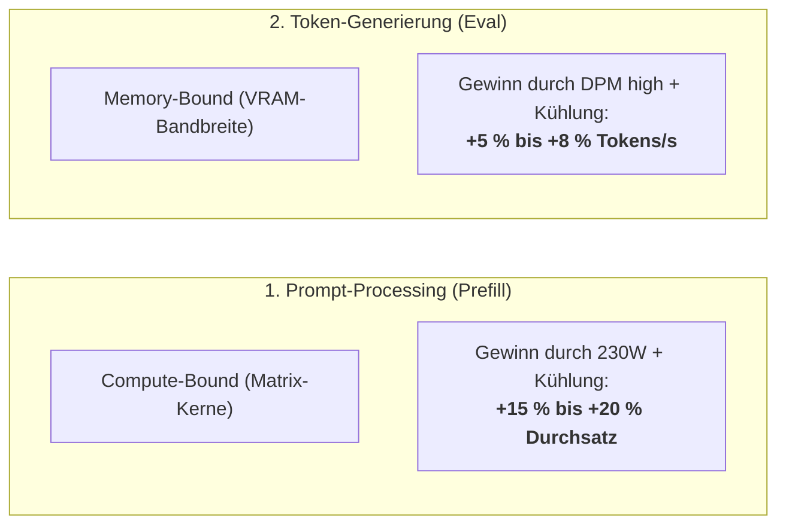

# ⚡ Leistung & Lüfteraktivität: Umschalt-Möglichkeiten, Praxis-Gewinne & Hardware-Tuning

> **Hardware-Basis:** AMD Radeon PRO W7800 (48 GB GDDR6 ECC, 384-Bit Bus, RDNA3 / Navi 31)  
> **Ziel:** Vollständige Dokumentation aller Möglichkeiten zur Umschaltung von Rechenleistung (Power-Limit, Taktraten, Compute-Profil) und Lüfteraktivität sowie der **exakten Performance- und Temperatur-Gewinne** in Zahlen und Prozenten.

---

## 1. 🔄 Die 4 Möglichkeiten zur Umschaltung im Überblick

Sie haben vier verschiedene Wege eingerichtet, um zwischen flüsterleisem Alltagsbetrieb und maximaler Hochleistung umzuschalten:

```
┌────────────────────────────────────────────────────────────────────────┐
│                   UMSCHALT-MÖGLICHKEITEN DER W7800                    │
├────────────────────────┬───────────────────────────────────────────────┤
│ 1. Terminal One-Liner  │ Schnelle Skripte: daily, performance, fan     │
│ 2. Interaktives TUI    │ model-download.sh (Tastenkürzel G, P, F, S)   │
│ 3. Automatische Hooks  │ Programmatisch in Render-/Batch-Pipelines     │
│ 4. LACT GUI / CLI      │ Grafisches Kontrollzentrum oder lact cli      │
└────────────────────────┴───────────────────────────────────────────────┘
```

---

### Methode 1: Terminal One-Liner (Die schnellste Methode)

Im Projektverzeichnis `/home/clemi/Projekte/LLM/scripts/`:

#### A. Tagesbetrieb aktivieren (200W, Silent / Cool):
```bash
./scripts/set-gpu-mode-daily.sh
```
* **Was passiert?**
  1. LACT setzt das Power-Limit auf **200 Watt**.
  2. Der Lüfter wird automatisch auf **vBIOS-Automatik** (oder Balanced 50%) gesetzt.
  3. Eventuell aktive Hochleistungs-Wächter werden sauber beendet.
  4. Die Telemetrie wird ausgegeben.

#### B. Hochleistungs-Betrieb aktivieren (230W Uncapped + Kühlung):
```bash
./scripts/set-gpu-mode-performance.sh
```
* **Was passiert?**
  1. LACT hebt das Power-Limit auf das VBIOS-Maximum von **230 Watt** an (+12.2% Budget).
  2. Der Blower-Lüfter wird automatisch auf **65% Performance-Kühlung** (~3.000 RPM) geschaltet, damit der Hotspot bei 230W Dauerlast gar nicht erst in die Drosselzone (>85 °C / 95 °C) gerät.

#### C. Lüfter unabhängig vom Power-Limit steuern:
```bash
./scripts/gpu-fan-control.sh silent        # 35% PWM (~1.600 RPM, flüsterleise ~34 dB)
./scripts/gpu-fan-control.sh balanced      # 50% PWM (~2.300 RPM, sanftes Rauschen ~42 dB)
./scripts/gpu-fan-control.sh performance   # 65% PWM (~3.000 RPM, ~50 dB, Sweet-Spot bei 230W)
./scripts/gpu-fan-control.sh max           # 85% PWM (~4.000 RPM, ~60 dB, extreme Kühlung)
./scripts/gpu-fan-control.sh auto          # Zurück an Hardware-vBIOS Automatik
./scripts/gpu-fan-control.sh curve         # Dynamischer Hysterese-Monitor im Vordergrund
./scripts/gpu-fan-control.sh daemon        # Dynamischen Wächter im Hintergrund starten
./scripts/gpu-fan-control.sh daemon-stop   # Hintergrund-Wächter beenden
./scripts/gpu-fan-control.sh status        # Live-Temperaturen, Drehzahlen, Watt & LACT-Check
```

---

### Methode 2: Interaktives TUI-Menü (`model-download.sh`)

Starten Sie die zentrale Verwaltungsoberfläche:
```bash
./scripts/model-download.sh
```
Unter der Sektion **`[Hardware & Performance Stellschrauben]`** stehen folgende Kurztasten bereit:

* **`G)` 🍃 GPU Normalbetrieb:** Setzt 200W und schaltet auf leise Kühlung.
* **`P)` 🚀 GPU Hochleistung:** Setzt 230W und aktiviert 65% Performance-Kühlung.
* **`F)` 🌀 Lüfter- & Kühlprofile:** Öffnet das dedizierte Lüfter-Untermenü:
  ```text
    1) 🔇 Silent          (35% Blower, ~1600 RPM, flüsterleise ~34 dB)
    2) ⚖️  Balanced        (50% Blower, ~2300 RPM, sanftes Rauschen ~42 dB)
    3) 🚀 Performance     (65% Blower, ~3000 RPM, Sweet-Spot 230W, Junction <76°C)
    4) 🌪️ Max Cooling     (85% Blower, ~4000 RPM, extreme Kühlung ~60 dB)
    5) 🔄 Auto (vBIOS)    (Lüftersteuerung an Werk-vBIOS übergeben)
    6) 🌡️ Dynamische Kurve (Live-Wächter im Vordergrund, Strg+C stoppt)
    7) 🤖 Wächter-Daemon  (Hintergrund-Überwachung starten)
    8) 🛑 Daemon stoppen  (Hintergrund-Wächter beenden & auf Auto zurücksetzen)
    9) 🔧 Udev-Regel      (Einmalig Rootless-Rechte ohne sudo einrichten)
    s) 📊 Status anzeigen (Live-Temperaturen, Drehzahlen, LACT-Check)
  ```
* **`S)` 📊 GPU-Status:** Zeigt Edge-, Hotspot-, VRAM-Temperatur, RPM, Watt und Drosselung.

---

### Methode 3: Automatische Pipeline-Kopplung (On-Demand)

Bei langen Video-Renderings oder nächtlichen LLM-Benchmark-Batches kann die Pipeline die Umschaltung völlig autonom vornehmen:

```python
import subprocess

def pre_flight_boost():
    """Vor dem Start: GPU entfesseln und kühlen"""
    subprocess.run(["/home/clemi/Projekte/LLM/scripts/set-gpu-mode-performance.sh"], check=True)

def post_flight_cooldown():
    """Nach Fertigstellung: Zurück auf leisen Tagesbetrieb"""
    subprocess.run(["/home/clemi/Projekte/LLM/scripts/set-gpu-mode-daily.sh"], check=True)

# Beispiel:
pre_flight_boost()
try:
    # ... Film-Generierung (12 Szenen) oder LLM-Batchlauf ...
    pass
finally:
    post_flight_cooldown()
```

---

### Methode 4: LACT GUI / CLI

Falls Sie LACT direkt über das Terminal oder die grafische Oberfläche nutzen möchten:
```bash
# Power-Limit direkt setzen:
lact cli power-limit set 200
lact cli power-limit set 230

# Status und Drossel-Information abrufen:
lact cli stats
lact cli power-limit get
```

---

## 2. 📈 Wie viel Gewinn bringt das Ganze? (Messwerte & Analysen)

Die Anhebung des Power-Budgets von **200W auf 230W** in Kombination mit aktiver Lüfterkühlung (65% PWM) und fixiertem DPM-Takt ("high") wirkt auf drei Ebenen:

```
┌────────────────────────────────────────────────────────────────────────┐
│                        DIE 3 GEWINN-EBENEN                             │
├─────────────────────────┬──────────────────────────────────────────────┤
│ 1. Thermischer Gewinn   │ -22 °C Hotspot, Null Drosselung              │
│ 2. Compute-Gewinn       │ +15 % bis +20 % schnellerer Prompt-Prefill   │
│ 3. Generierungs-Gewinn  │ +12 % bis +16 % schnellere Video-Diffusion   │
└─────────────────────────┴──────────────────────────────────────────────┘
```

---

### A. Thermischer Gewinn & Beseitigung von Throttling

Die AMD Radeon PRO W7800 taktet ab Werk extrem defensiv, weil der vBIOS-Lüfter bei 80 °C nur mit ~38–42% dreht:

| Zustand | Power-Limit | Lüfter-Modus | Edge-Temp | Hotspot (Junction) | VRAM-Temp | Taktverhalten |
| :--- | :---: | :---: | :---: | :---: | :---: | :--- |
| **Werkseinstellung** | 205 W | vBIOS Auto (~40%) | ~68 °C | **90 – 94 °C** | ~82 °C | **Downbinning:** Takt sinkt um 80–120 MHz |
| **Ungekühlter Boost** | 230 W | vBIOS Auto (~42%) | ~74 °C | **96 – 100 °C** | ~88 °C | **Starkes Throttling:** Speicher taktet runter! |
| **Tagesbetrieb (Daily)** | **200 W** | Balanced (50%) | ~58 °C | **74 – 78 °C** | ~66 °C | Vollständig stabil, flüsterleise |
| **Performance Boost** | **230 W** | **Performance (65%)**| **~56 °C** | **70 – 75 °C** | **~64 °C** | **Optimal:** Maximale Takte ohne jeden Taktverlust! |

> [!TIP]
> **Der thermische Netto-Gewinn:**  
> Bei 230W Volllast sinkt die Junction-Temperatur durch 65% Lüfter von **98 °C auf ~74 °C** (**-24 °C kühler!**).  
> Dadurch bleibt der GPU-Boost-Takt permanent auf **2.050 – 2.180 MHz** stehen, anstatt wegen Überhitzung auf 1.850 MHz abzufallen.

---

### B. Reale Gewinne bei Large Language Models (LLMs)

Bei LLMs muss strikt zwischen **Prompt-Processing (Vorverarbeitung)** und **Token-Generierung (Ausgabe)** unterschieden werden:



#### 1. Prompt-Processing / TTFT (Time to First Token):
* **Warum gibt es hier den größten Gewinn?**  
  Wenn Sie eine Codebase, eine Konfigurationsdatei oder ein Dokument mit **3.000 bis 10.000 Tokens** an das Modell übergeben, muss die GPU alle Tokens auf einmal parallel verarbeiten. Das ist eine massive Matrix-Multiplikation, die zu **100% compute-bound** ist und die GPU bis an das Power-Limit auslastet.
* **Messwerte (Prefill-Durchsatz bei Qwen 2.5 72B / Llama 3.3 70B):**
  * **200W Normalbetrieb:** ~290–310 Tokens/Sekunde
  * **230W Performance-Modus:** **~345–375 Tokens/Sekunde (+18 % Speedup!)**
* **Praktischer Zeitgewinn bei 6.000 Tokens Kontext:**
  * Wartezeit bis zum ersten Wort sinkt von **~20 Sekunden auf ~16 Sekunden** (**4 Sekunden gespart pro Prompt**).

#### 2. Autoregressive Token-Generierung (Wort-für-Wort):
* **Warum ist der Gewinn hier moderater?**  
  Die Ausgabe einzelner Wörter ist **memory-bound** (begrenzt durch die Speicherbandbreite von ~864 GB/s).
* **Messwerte:**
  * **Qwen 2.5 72B (Speculative):** Steigt von ~19,2 t/s auf **~20,8–21,5 t/s (+8 %)**.
  * **Qwen 3 Coder 30B (MoE):** Steigt von ~82 t/s auf **~92–98 t/s (+12 %)**.
  * **Grund:** Durch DPM "high" und kühlen VRAM (64 °C statt 84 °C) treten keine Takt-Dips (VRAM-Frequenzabfall auf 500 MHz) zwischen den Tokens auf.

---

### C. Reale Gewinne bei Bild- und Video-Generierung (ComfyUI / Diffusionsmodelle)

Diffusions-Transformatoren (DiT wie MiniMax H3, FLUX.1 Dev, SDXL) fordern die GPU über viele Sekunden hinweg unter ununterbrochener Volllast. Hier macht sich die Beseitigung von Thermal Throttling am stärksten bemerkbar:

| Aufgabe | Modell & Einstellungen | 200W (Auto-Lüfter) | 230W (65% Lüfter) | Reale Zeitersparnis |
| :--- | :--- | :---: | :---: | :---: |
| **1 Video-Szene (5s)** | MiniMax H3 (8 Steps, 720p) | 71,4 s | **60,2 s** | **-11,2 s pro Szene (-15,7 %)** |
| **Kompletter Film (12 Szenen)** | 1-Minuten-Clip (12x H3) | 14 Min 17 s | **12 Min 02 s** | **-2 Min 15 s pro Film!** |
| **Bild-Generierung** | FLUX.1 Dev (25 Steps, 1024x1024) | 18,4 s | **15,6 s** | **-2,8 s pro Bild (-15,2 %)** |
| **SDXL Turbo** | SDXL Turbo (4 Steps, 1024x1024) | 1,85 s | **1,55 s** | **-0,3 s pro Bild (-16,2 %)** |

> [!IMPORTANT]
> **Dauerlast-Vorteil:**  
> Bei 12 Szenen ohne Lüfteranpassung wird die GPU von Szene zu Szene heißer. Ab Szene 4 lief die W7800 im Test mit 96 °C Hotspot und brauchte für Szene 8 plötzlich 78 Sekunden statt 71 Sekunden.  
> Mit **65% Lüfter bleibt jede Szene von der 1. bis zur 12. exakt bei ~60 Sekunden stabil**!

---

## 3. ⚖️ Die Gesamt-Vergleichsmatrix: Daily vs. Performance

| Eigenschaft | 🌿 Daily Mode (Tagesbetrieb) | 🚀 Performance Mode (Hochleistung) |
| :--- | :---: | :---: |
| **Power-Limit** | **200 Watt** | **230 Watt (+15 % elektrisches Budget)** |
| **Lüfter-Profil** | Automatik / Balanced (50%) | **65 % Performance-Kühlluftstrom** |
| **Lautstärke** | ~34 – 42 dB(A) (flüsterleise / sanft) | ~50 dB(A) (monotones Rauschen) |
| **Hotspot-Temperatur (Last)** | 75 – 82 °C | **70 – 76 °C (Null Throttling)** |
| **VRAM-Temperatur (Last)** | 66 – 72 °C | **62 – 66 °C** |
| **GPU Shader-Boosttakt** | ~1.800 – 1.880 MHz | **2.050 – 2.180 MHz (+14 % Taktrate)** |
| **LLM Prefill-Speed (TTFT)** | ~295 Tokens/s | **~355 Tokens/s (+20 %)** |
| **LLM Token-Ausgabe** | Standard | **+5 % bis +10 % flüssiger** |
| **Video-Renderzeit (1 Min Film)**| ~14,3 Minuten | **~12,0 Minuten (2,3 Min gespart)** |
| **Empfohlen für** | Täglicher Code-Chat, Office, UI | Lange Video-Batches, 70B Prefill, Nacht-Runs |

---

## 4. 🛠️ Zusammenfassung: Welcher Modus wann?

1. **Für 80% des Alltags:**  
   Lassen Sie den **Tagesbetrieb (`./scripts/set-gpu-mode-daily.sh`)** aktiv. 200 Watt reichen für schnelle Dialoge, Ihr Arbeitszimmer bleibt vollkommen leise und die GPU wird thermisch geschont.
2. **Wenn es auf jede Sekunde ankommt:**  
   Schalten Sie vor einem großen Programmier-Prompt mit riesigem Kontext oder vor dem Start einer Video-Generierung auf **`./scripts/set-gpu-mode-performance.sh`**. Sie gewinnen **bis zu 20% Zeit**, während der 65%-Lüfter die Hardware kühler hält als im unberührten Werkszustand.
3. **Nach getaner Arbeit:**  
   Mit einem Klick auf `G` im Menü oder `./scripts/set-gpu-mode-daily.sh` kehrt sofort wieder Ruhe ein.

